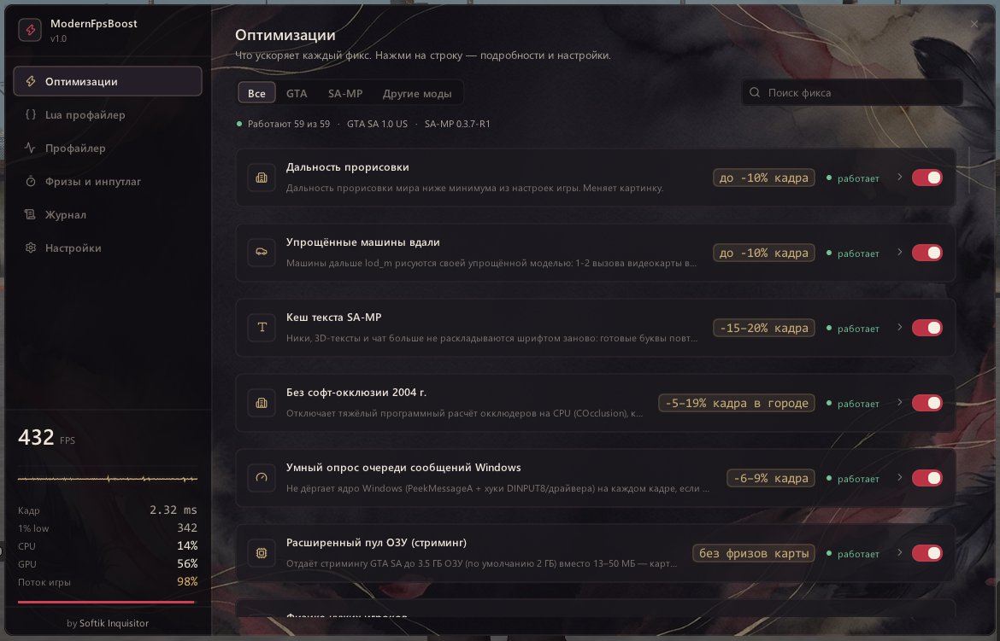
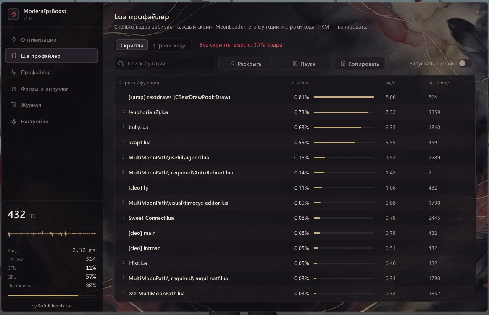
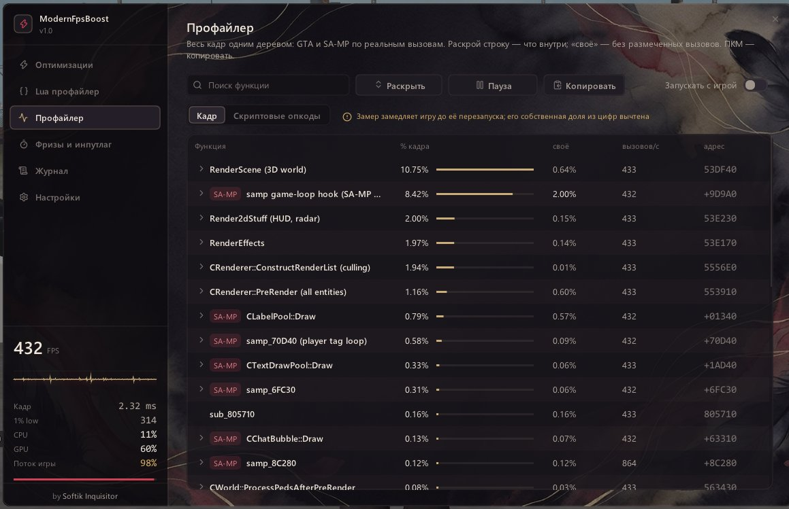

# ModernFpsBoost

[Русский](README.md) | **English**

Deep CPU/FPS optimization suite for **GTA:SA 1.0 US** + **SA-MP 0.3.7 R1 / R2 / R3-1 / R4 / R5-1** and **0.3.DL-R1**.
Every optimization is an individual section in `ModernFpsBoost.ini` (`enabled=1/0`) and can be toggled live in-game via the **F9** menu.

Author: [Softik Inquisitor](https://vk.ru/miurawr)

## Download

* **Direct download (latest CI build):** [ModernFpsBoostBySoftikInquisitor.vk-miurawr.asi](https://github.com/xKumorio/ModernFpsBoost/releases/latest/download/ModernFpsBoostBySoftikInquisitor.vk-miurawr.asi)
* **Releases page:** [Releases](https://github.com/xKumorio/ModernFpsBoost/releases)
* **CI builds from source:** [GitHub Actions](https://github.com/xKumorio/ModernFpsBoost/actions)

### Installation
1. Drop `ModernFpsBoostBySoftikInquisitor.vk-miurawr.asi` into your GTA:SA root folder (next to `gta_sa.exe`).
2. `ModernFpsBoost.ini` is generated automatically on first launch.
3. To switch everything to English (menu + `.ini` comments), set `english=1` under `[Language]` at the very top of `ModernFpsBoost.ini` (or toggle **Language -> English** in the **F9 -> Settings** tab). On next launch, `.ini` comments rewrite to English automatically while preserving all your settings.
4. Press **F9** in-game to open the settings menu, live fix stats, and built-in Lua / SA-MP / GTA / Stutter profilers.

## In-Game Menu (F9)





## Key Optimizations

* **GTA:SA Engine (SSE2 / SSE3 / SSE4.1):**
  * Ray, sphere, triangle, box, and camera line collisions rewritten in SSE2 (`ColTriSSE`, `ColBoxSSE`, `ColLinesSSE`, `ColPlaneCache`) with full `OpenSAA` / `LimitAdjuster` / `0.3.DL` compatibility
  * RenderWare & `CMatrix` math, camera frustum culling, ped skinning, and skeleton animation blending in SSE2 (`MatrixSSE`, `CMatrixSSE`, `FrustumSSE`, `AnimMathSSE`, `AnimBlendSSE`, `FrameSyncFast`, `SkinMatrixSSE`)
  * `Fx_c` particle math, `atan2`, `floor/ceil` (SSE4.1), `(int)float` (SSE3), `stricmp` (`FxParticlesSSE`, `FastAtan2SSE`, `FloorSSE4`, `FtolSSE3`, `FastStricmpSSE`)
  * Disables legacy 2004 PS2 CPU software occlusion (`OcclusionOff`), expands streaming RAM pool up to 3.5 GB with automatic LAA check (`StreamMemBoost`), per-frame unpack budget (`StreamBudget`), O(1) model name table (`ModelNameLookup`)
  * Smart Windows message pump with instant `GetInputState` wakeup (`MessagePumpFix`), `SetCursorPos` throttling (`CursorCenterFix`), batched radar rendering (`RadarBatch`), vehicle env-map cache (`EnvMapCache`), distant vehicle LODs and draw distance (`VehicleLod`, `DrawDistance`, `PedDrawDistance`)
* **SA-MP (all 6 versions: 0.3.7 R1-R5 and 0.3.DL-R1):**
  * Bit-exact `ID3DXFont::DrawText` layout cache and material font reuse (`TextCache`, `MaterialFontCache`)
  * Batched overhead HP/armor bars in 1 `DrawPrimitiveUP` per frame (`HealthBarBatch`), targeted UI StateBlock replacing `D3DSBT_ALL` (`SampStateBlockFix`), lazy nametag `Begin/End` (`PlayerTagState`)
  * Fast `CObjectPool::DrawLast` without 8 KB stack zeroing or O(N^2) bubble sort (`ObjectDrawLastFast`), branchless SSE2 material-text scan (`ObjectMatTextFast`), off-screen object and gang zone culling (`SampObjectCull`, `GangZoneCull`)
  * Nametag LOS raycast cache (`NametagLOSCache`), object & accessory lookup caches (`ObjectFindCache`, `AccessoryFindCache`), `VirtualProtect` cache (`UnprotectCache`), F1/F5/F10 key poll cache (`SampKeyPollCache`), removal of main-thread `Sleep(1)` model waits (`SampModelWait`)
* **Third-Party Mod Compatibility:**
  * `SAMPFUNCS` draw-call bypass (`SampfuncsDrawFast`), dead loop removal in `SilentPatchSA` `CObject::Render` (`SilentPatchObjectFix`), `VirtualProtect` caching for `MoonLoader` and ASI plugins (`LuaMemProtectCache`, `AsiMemProtectCache`), BASS audio `Sleep(1)` offload (`AudioSleepFix`), `RealSkybox` disk log suppression (`SkyboxLogOff`).

## Building from Source

Requires Visual Studio 2022 (C++ x86 build tools):

```bat
build.bat
```

Output binary: `build\ModernFpsBoostBySoftikInquisitor(vk-miurawr).asi`.

---

(c) 2026 [Softik Inquisitor](https://vk.ru/miurawr). All rights reserved.
